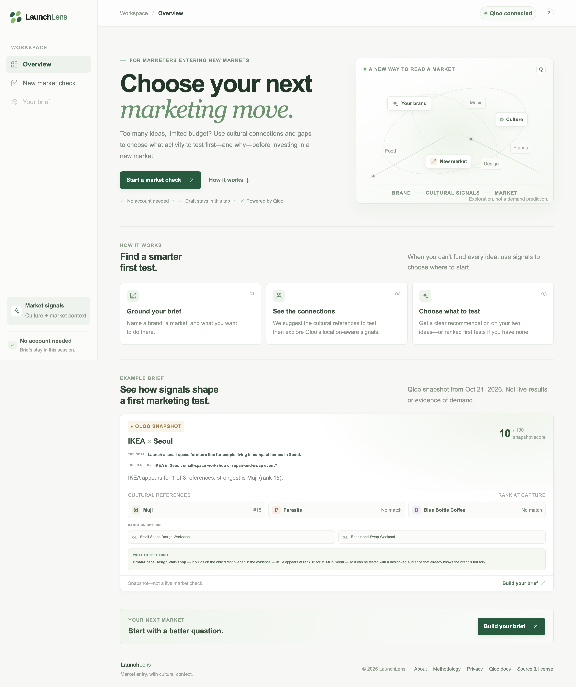
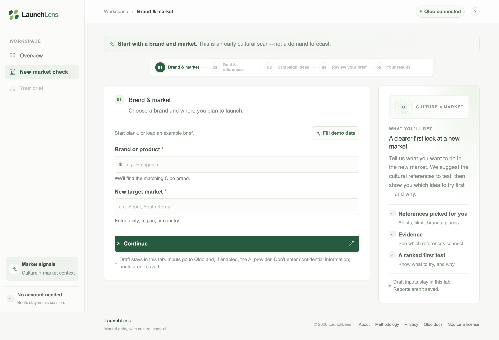
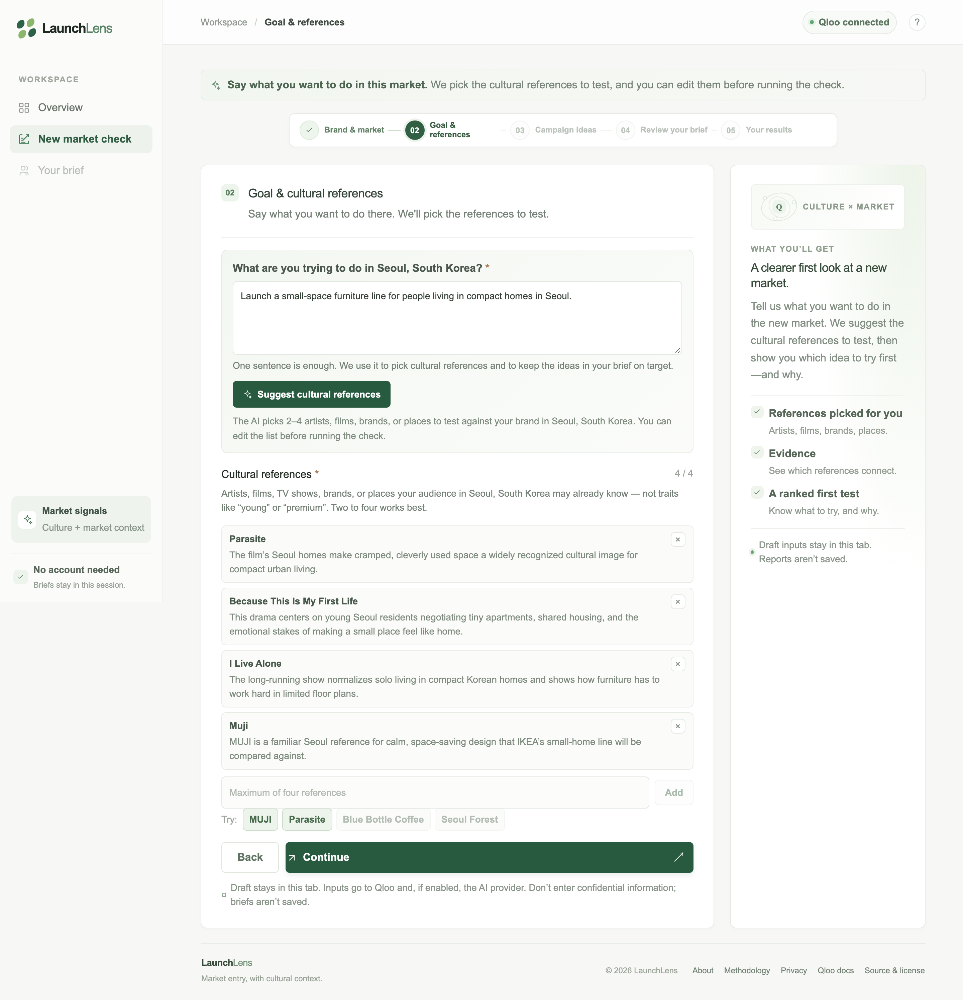
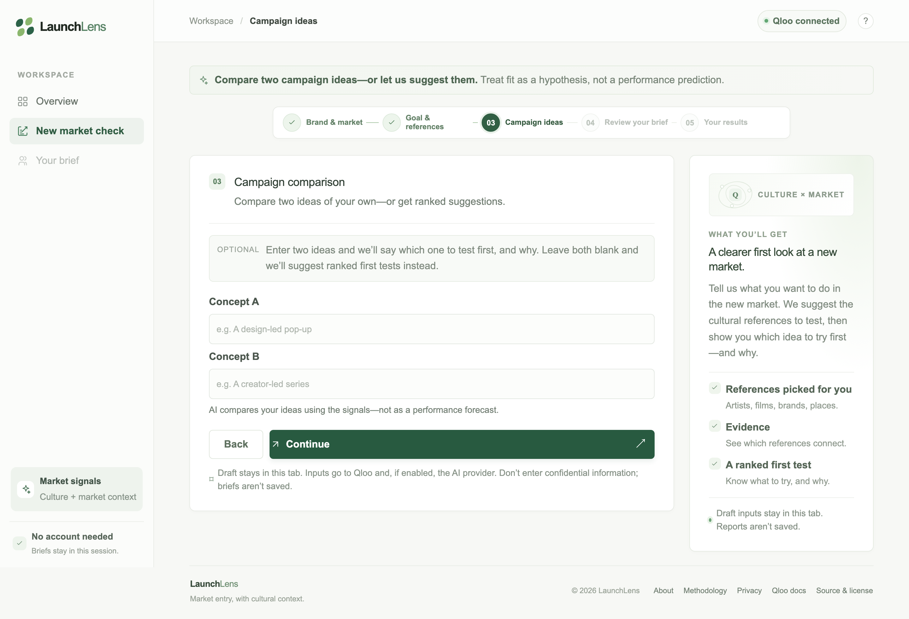
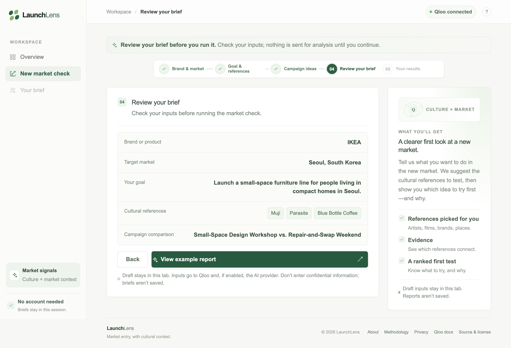
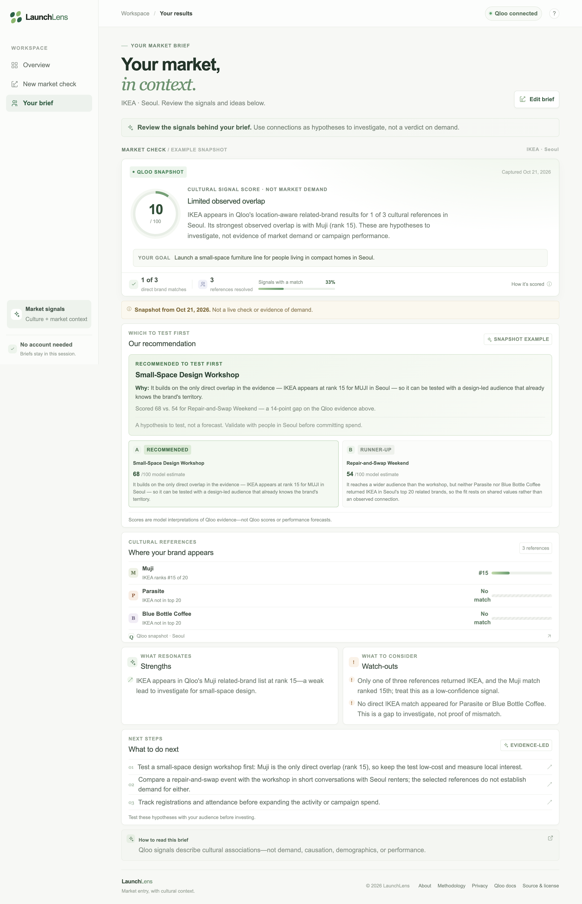
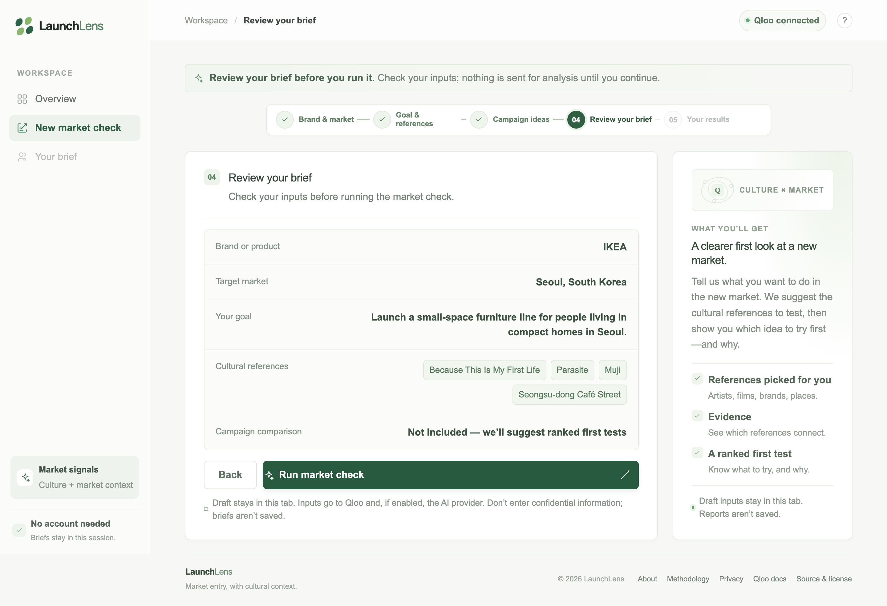
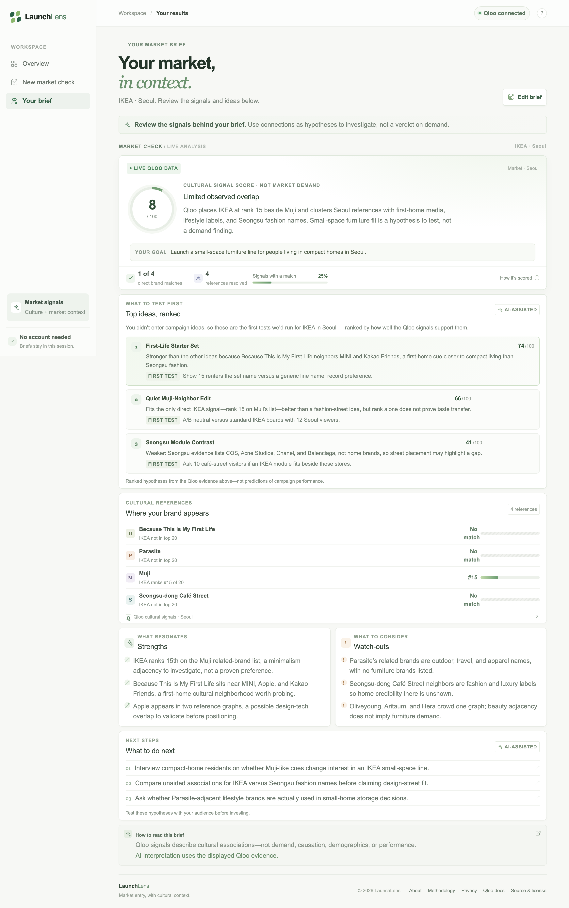

<p align="center">
  <picture>
    <source media="(prefers-color-scheme: dark)" srcset="public/logo-dark.png">
    
  </picture>
</p>

# LaunchLens — Choose What to Test in a New Market

LaunchLens helps brand and strategy teams decide **which marketing activity to test first in a new market**. Give it a brand, market, and one-sentence goal. Add 2–4 cultural references (or let xAI suggest them), check them against Qloo's location-aware signals, and see the connections and gaps.

**Live demo:** [getlaunchlens.vercel.app](https://getlaunchlens.vercel.app)

> **Prototype:** Built for the [Qloo Agentic Hackathon](https://qloo.devpost.com/). It is a cultural-context layer for early exploration, not a replacement for audience research, market sizing, or social listening. See [Where LaunchLens fits](#where-launchlens-fits).

## What it does

- **Compare two ideas:** enter two campaign ideas for a side-by-side comparison and a recommendation, AI-scored when xAI is configured.
- **Start without ideas:** leave them blank for ranked, evidence-led first tests.
- **Inspect the evidence:** see which references connect, at what rank, and where the gaps are.
- **Treat it as a hypothesis:** the result is a testable first move, not a demand forecast.

## Example: IKEA in Seoul

A hypothetical planning exercise, not a claim about IKEA's plans:

- **Goal:** Connect with people interested in small-space living in Seoul.
- **Cultural references:** MUJI, *Parasite*, and Blue Bottle Coffee—starting points for Qloo's related-brand check in Seoul. They are not claims about what all Seoul residents like; edit the list before running a check.
- **Ideas to compare:** a small-space design workshop vs. a repair-and-swap event.
- **What it shows:** whether those references connect to IKEA in Seoul, and where the signals are missing. The optional AI comparison explains which activity looks like the better first test.

The unchanged example opens a bundled Qloo snapshot: **Fill demo data** loads the brief, and **View example report** opens the snapshot without an API call. Any edit switches the final action to a live **Run market check**.

Presenter materials: [6-minute walkthrough](scripts/NOTES.md) and [live scenarios](scripts/EXAMPLES.md).

## Run locally

Requirements: Node.js 20.9+ and Bun 1.3.5+.

```bash
bun install
cp .env.example .env.local
bun run dev
```

Open [http://localhost:3000](http://localhost:3000).

### Environment

| Variable | Required | Purpose |
| --- | --- | --- |
| `QLOO_API_KEY` | For live checks | Qloo hackathon API key. |
| `QLOO_BASE_URL` | No | Defaults to `https://hackathon.api.qloo.com`. |
| `XAI_API_KEY` | No | Enables reference suggestions, summaries, and campaign comparisons. |
| `XAI_MODEL` | No | Defaults to `grok-4.7`. |
| `KEYVALUE_APP_KEY` | No | Shared daily counters across instances. |
| `RATE_LIMIT_SALT` | No | Salt for anonymous IP identifiers; falls back to `KEYVALUE_APP_KEY` or `QLOO_API_KEY`. |
| `LAUNCHLENS_ANALYSIS_ENABLED` | No | Set to `false` to pause live analysis. |

Hackathon keys only work with `hackathon.api.qloo.com`, and Qloo expects the key in the `X-Api-Key` header. Keep these server-only: never prefix them with `NEXT_PUBLIC_` or commit `.env.local`.

Without `XAI_API_KEY`, reference suggestions are disabled. Analyses still return a deterministic evidence-based summary and ranked first tests, or an unscored comparison when two ideas are supplied. xAI requests use `store: false`.

## How it works

1. Resolve the brand and 2–4 cultural references with Qloo entity search. References can be suggested from the goal and edited.
2. Fetch Qloo related-brand signals for each reference in the target market.
3. Score the brand's position in those lists.
4. Explain connections and gaps, then suggest next steps. With two user ideas and xAI, compare them; with no ideas, rank up to three first tests.

**Cultural signal score:** an overlap index from 0–100, not a grade. Rank 1 of 20 scores 100, rank 20 scores 5, and a missing match scores 0; the app averages those values across references. It reflects coverage and rank, not demand, brand quality, cultural fit, or campaign performance. A low score can simply mean the chosen references did not surface the brand; check the per-reference rows for gaps vs. low ranks. Do not use the score to rank markets against each other.

## Why Qloo

Qloo keeps LaunchLens from being an LLM with an opinion. Its cross-category, location-aware relationships provide a consistent evidence base:

- **Location-aware:** the same brand and reference can connect differently by market. Qloo returns results for the selected locality, not one global average.
- **Cross-category:** Qloo connects brands to artists, films, TV shows, brands, and places. LaunchLens can compare character-led, place-led, and partner-led strategies on the same evidence.
- **Ranked, not binary:** the app shows whether the brand appears at #3 or #15, or not at all. A gap is a question to validate, not a rejection.

Qloo retrieves observed relationships; the AI interprets them. Related-brand results can include competitors or adjacent brands, but the question is not “who are the competitors?” It is “does this cultural reference connect to the brand in this market, and how strongly?” See the [About page](https://getlaunchlens.vercel.app/about) and [Qloo capabilities](https://www.qloo.com/capabilities).

## Where LaunchLens fits

LaunchLens answers a narrower question than the tools around it: which cultural connections in a target market are worth testing alongside the business metrics you already have.

| Tool | Question it answers | Where LaunchLens differs |
| --- | --- | --- |
| [GWI](https://www.gwi.com/platform) — audience research | Reported behaviors, attitudes, and audience segments from survey data | Adds a fast Qloo-based view of how selected references connect with a brand in a locality. Does not replace representative survey research. |
| [Similarweb](https://www.similarweb.com/corp/web/market-intelligence/) — digital market intelligence | Digital market size, demand, competition, and online behavior | Does not estimate traffic or market opportunity; adds a cultural-connection question to test alongside those metrics. |
| [Brandwatch Listen](https://www.brandwatch.com/products/listen/) — social listening | Public online conversations, trends, and sentiment | Not a listening tool. Uses Qloo's cross-category relationships to explore brand/reference connections. |

Use LaunchLens alongside established research and market data—not instead of them.

## Architecture

- `src/app/page.tsx` — dashboard, four-step setup wizard plus results view, demo state, and validation/loading/error UX.
- `src/app/api/analyze/route.ts` — validates inputs; orchestrates Qloo search, insights, scoring, and narrative generation.
- `src/app/api/cues/route.ts` — proposes cultural references, keeping only the ones Qloo can resolve.
- `src/app/api/status/route.ts` — reports whether server-side integrations are configured; never returns secrets.
- `src/app/about/page.tsx` — methodology, an illustrative Qloo response, competitive landscape, privacy, and limits.
- `src/lib/qloo.ts` — isolated Qloo API client and response normalization.
- `src/lib/cues.ts`, `src/lib/narrative.ts`, `src/lib/xai.ts` — reference suggestions, narrative generation, and xAI client.
- `src/lib/analysis.ts` — transparent score calculation and labeled fallback content.
- `src/lib/cached-example.json` — bundled IKEA/Seoul snapshot used by the demo.
- `scripts/NOTES.md`, `scripts/EXAMPLES.md` — presenter script and demo scenarios.
- `scripts/screenshots.ts` — headless-Chrome walkthrough capture.

### Qloo endpoints used

- `GET /search` resolves the brand and each cultural reference to a Qloo entity ID.
- `GET /v2/insights` with `filter.type=urn:entity:brand`, `signal.interests.entities=<reference entity ID>`, and `signal.location.query=<leading market locality>` returns location-aware related-brand results. Qloo returns the resolved locality with the results.

The market is location context, not a measure of demand or local awareness. The connector uses the hackathon base URL by default and sends `X-Api-Key` server-side. It does not use the legacy `/recs` or `/recommendations` endpoints. API results are reduced to entity names, IDs, and ranks before reaching the browser; raw payloads are not stored. See the [Qloo API guide](https://docs.qloo.com/reference/qloo-llm-hackathon-developer-guide).

## Safeguards

- No accounts or report database: analyses live in the current page session and are not saved.
- The analysis and reference-suggestion endpoints accept same-origin JSON only, cap request bodies at 8 KB, and reject a hidden honeypot field. A single analysis takes 2–4 references and one goal of 400 characters or fewer.
- Limits: 30 requests per minute per anonymous IP; 3 analyses and 10 AI reference suggestions per IP per UTC day; 50 of each globally or per server process per UTC day by default.
- Identifiers are an HMAC of the client IP only. `KEYVALUE_APP_KEY` optionally enables shared daily counters; if the shared store is unavailable, the app falls back to in-process caps.
- `LAUNCHLENS_ANALYSIS_ENABLED=false` is an operator kill switch. Configure provider quotas and billing alerts for Qloo and xAI as well.
- Inputs go to Qloo and, when enabled, xAI. xAI requests set `store: false`; LaunchLens does not log query content or persist reports server-side.

**Deployment note:** without `KEYVALUE_APP_KEY`, the daily caps are in-memory only. They reset on restart and are not shared across serverless instances. Pair them with edge/WAF rate limits, provider spend limits, and optionally a CAPTCHA for a heavily used public deployment. No Redis is required.

## Verify and deploy

```bash
bun run test
bun run lint
bun run build
```

Deploy to Vercel and configure `QLOO_API_KEY`; optionally set `XAI_API_KEY`, `XAI_MODEL`, `KEYVALUE_APP_KEY`, `RATE_LIMIT_SALT`, and `QLOO_BASE_URL` (which defaults to the hackathon host). Redeploy after changing environment variables. The preloaded example works without credentials; other market checks require live API access.

## Product plan

**Now:** help a brand or agency strategist choose a useful first test. Keep the flow fast, show the source signals, label interpretations as hypotheses, and keep the demo open without accounts.

**Next:**

1. Validate the workflow with brand strategists, agency planners, and market-expansion teams.
2. Improve entity resolution with user confirmation and compare multiple reference sets and markets side by side.
3. Add shareable/exportable briefs with cited signals, assumptions, open questions, and a decision log.
4. Add accounts and team workspaces only when users ask to save, revisit, or collaborate on analyses.
5. Compare hypotheses with later launch or campaign results where customers agree to share outcomes.

**Monetization hypothesis:** a workspace subscription for repeat users (saved briefs, market comparisons, collaboration, exports), an enterprise/API tier for larger organizations, and optional facilitated workshops or analyst-reviewed briefs. Validate repeat usage and willingness to pay before building these.

## Limitations

- The analysis uses a small set of cultural references and a top-20 related-brand list, not a representative audience sample.
- Qloo may return ambiguous matches; LaunchLens uses the first search result and displays the resolved name.
- Location matching can be fuzzy; verify the resolved locality. Affinity does not measure local awareness, demand, distribution readiness, or market size.
- A missing brand in Qloo's lists means no observed overlap—not a negative preference.
- Campaign comparisons are optional model-generated hypotheses. AI-scored comparisons require an xAI key; without it, the app shows an unscored placeholder. They are not predictions or Qloo scores.
- Suggested references are model picks filtered only for resolvability, not Qloo findings. A vague goal produces generic references.
- This MVP has no user accounts or saved reports. Manual drafts persist only in the current tab via session storage.

## Screenshots

Captured from the running app with `bun run screenshots`, which drives headless Chrome through the real flow.

<details>
<summary>View screenshots</summary>

**1. Overview**



**2. Brand & market**



**3. Goal and suggested cultural references**



**4. Optional campaign comparison**



**5. Review the brief**



**6. Demo results**



**7. Live brief with no campaign ideas**



**8. Live results with ranked first tests**



</details>
